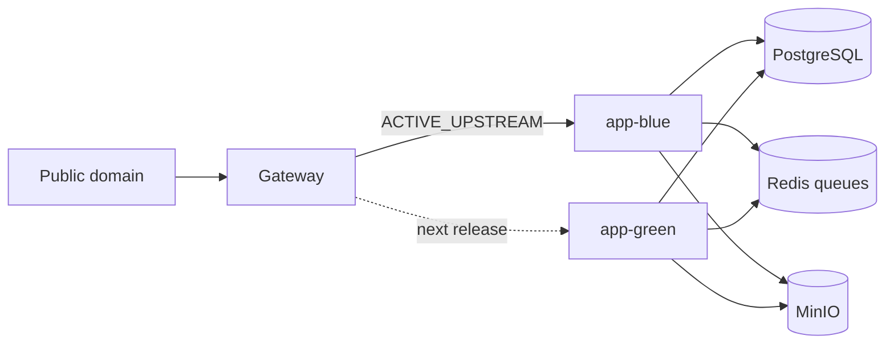

# Blue/green release runbook

The first production promotion was explicitly authorized and completed on 2026-09-16. **Current state and exact rollback identities are in [the production promotion record](production-promotion-20260916.md).** `backend` now owns the unchanged public hostname as a gateway to active `app-green`; `app-blue` retains the previous compatible Green image in standby. The older pre-v3 production binary is archived and must not be used for normal rollback. Both current application slots use production dependencies; neither public slot URL is an isolated writable preview.

The original preparation/rehearsal notes below remain historical context. For subsequent switches, use `backend.ACTIVE_UPSTREAM` as the authoritative selector; the separate `gateway` alias follows `backend`.

## Historical writable Green preview (before production promotion)

To support complete form and Studio testing, `app-green` uses `green-postgres`, `green-redis`, `green-storage` (private `green-preview` bucket) and `green-mail` (captured SMTP only). Authentication secrets are separate; payments are unconfigured. Only synthetic acceptance records were seeded. `GREEN_ISOLATED_PREVIEW=true`, `DEPLOYMENT_MODE=active` and `RUN_MIGRATIONS=false` identify this setup. See [form and Studio acceptance](form-studio-acceptance.md) for verification and resource identities.

Before using Green as a production candidate, stop its preview workers and reconnect it to the production dependency set and production secrets **in standby mode**. Remove `GREEN_ISOLATED_PREVIEW`, keep `RUN_MIGRATIONS=false`, deploy the reviewed immutable release and verify standby refusal of writes. Do not transfer preview data. Only then follow the promotion steps below. Never point the public gateway at this isolated test instance.

## Scope

Modules: backend boot/config, global HTTP guard, BullMQ processor registration, health response, combined container startup, Railway app/gateway configuration and release tooling. Tables and Prisma schema: none. Auth, pricing, saved projects and business rules: unchanged.

Assumptions: both slots use the same immutable application source, production data stays in one PostgreSQL/Redis/MinIO set, one slot owns workers at a time, and the gateway is the only public production entry point.



## Runtime contract

| Variable | Active slot | Standby slot |
|---|---|---|
| `DEPLOYMENT_SLOT` | `blue` or `green` | opposite slot |
| `DEPLOYMENT_MODE` | `active` | `standby` |
| `RUN_MIGRATIONS` | `false` after bootstrap | `false` required |
| `RELEASE_SHA` | exact deployed Git SHA | exact deployed Git SHA |

Set the stable gateway URL as `FRONTEND_ORIGIN`. Add the two exact Railway preview origins to `FRONTEND_PREVIEW_ORIGINS` as a comma-separated allowlist; no wildcard origins are accepted.

Standby behavior is fail-closed: no processor/scheduler providers, no startup migration, and POST/PUT/PATCH/DELETE return HTTP 503 with `DEPLOYMENT_STANDBY`. GET/HEAD/OPTIONS and `/api/v1/health` remain available. Health includes `release.slot`, `release.mode` and `release.sha` only for requests carrying `X-Health-Token` equal to `HEALTH_DETAILS_TOKEN` (E-admin-platform-56); the public body is exactly `{"status":"ok"}`.

## One-time Railway setup

1. Upgrade capacity before adding services. The current project has `backend`, Postgres, Redis, MinIO and Mailpit; adding an inactive application and gateway brings the total to seven services.
2. Preserve the existing `backend` service as the initial Blue slot; rename it only during an approved maintenance window. Add `app-green` from `Dockerfile.app` and set its config path to `/railway.json`.
3. Add `gateway` from `deploy/gateway` as its build root. Set `ACTIVE_UPSTREAM=backend.railway.internal:3000` while the current service keeps its existing name, then move the public/custom domain only after the rehearsal.
4. Give both app slots the same production service references and secrets. Set Green to `standby` and `RUN_MIGRATIONS=false` before its first start. Configure the exact Blue/Green service URLs in `FRONTEND_PREVIEW_ORIGINS`. Never copy production secrets into a separate staging project.
5. Keep an isolated Railway staging environment/project with its own data for mutation, payment, email and migration rehearsals.

## Prepare a candidate

1. Work in a feature branch/worktree. Do not edit the deployed release branch in place.
2. Pass CI, production-image build and isolated smoke checks.
3. Create an immutable annotated release tag containing the full Git SHA.
4. Push the tag (`git push origin refs/tags/release/<name>`) and wait for CI. `node tools/release/require-green-ci.mjs --sha <full-sha>` MUST pass before any `railway up`: it accepts only a completed, successful `.github/workflows/ci.yml` run from a `push` (release tag or main) or `workflow_dispatch` event on that exact SHA; a pull-request run is not enough.
5. Deploy that exact clean checkout to the inactive service with `DEPLOYMENT_MODE=standby`, `RUN_MIGRATIONS=false`, the inactive `DEPLOYMENT_SLOT`, and `RELEASE_SHA`. Before the first release containing E-admin-platform-56, set the same `HEALTH_DETAILS_TOKEN` (`openssl rand -hex 32`) on BOTH slots with `railway variables --service <slot> --set HEALTH_DETAILS_TOKEN=... --skip-deploys`.
6. Verify the real slot identity and localized entry pages. Run it from the release worktree (NOT from `F:\Cozy Fable`, which is linked to `green-mail`); `railway run` only injects `HEALTH_DETAILS_TOKEN` into the local process (it cannot reach `*.railway.internal`), so `--url` must be the slot domain today or a temporary domain once the PO removes the slot domains. The token is read only from the environment, never from arguments:

```powershell
railway run --service app-green node tools/release/verify-slot.mjs --url https://<inactive-service-or-temporary-domain> --slot green --mode standby --sha <full-sha>
```

Without the token a new release fails with "Health details hidden: run with HEALTH_DETAILS_TOKEN"; older rollback releases still return the full body and pass without it.

Run all write journeys in isolated staging. Production standby is a read-only preview.

## Promote Green while Blue is active

1. Record Blue and Green deployment IDs, image digests, SHAs, variables, migration list, queue/outbox counts and a database backup/restore checkpoint. The backup checkpoint is a "Run now" of the `backup-daily` Railway service plus the new `cozy-prod/db/daily/<stem>.dump.age` object in the off-site bucket (docs/08 "Backup si restaurare"), not a manual dump on a PC.
2. Classify rollback compatibility. Any change to Prisma, workers/queues, auth/session semantics, idempotency, provider side effects or saved JSON formats requires a specific backward-reader test.
3. Apply reviewed additive migrations once. Keep destructive cleanup for a later release after both slots no longer need the old shape.
4. Redeploy Blue as `DEPLOYMENT_MODE=standby` and `RUN_MIGRATIONS=false`. Wait for health to report `blue/standby`. The gateway still serves Blue reads; writes now receive a temporary 503. Confirm Blue processors and schedules are absent.
5. Redeploy Green as `DEPLOYMENT_MODE=active`, still with `RUN_MIGRATIONS=false`. Wait for `green/active`, then confirm exactly one worker generation, stable queues and no duplicate notifications.
6. Change gateway `ACTIVE_UPSTREAM` to `app-green.railway.internal:3000`. Railway health checks `/api/v1/health` through the gateway before replacing its prior deployment.
7. Verify the public URL reports `green/active` (with the token: `railway run --service app-green node tools/release/verify-slot.mjs --url https://<public host> --slot green --mode active --sha <full-sha>`), then check that the anonymous body is exactly `{"status":"ok"}` (`curl -s https://<public host>/api/v1/health`) and that `curl -sI https://<public host>/ro | grep -i x-robots-tag` prints nothing, then run login/refresh, a disposable draft write/read, SAFE upload, PDF, Socket.IO reconnect and representative Studio persistence.
8. Keep Blue deployed in standby as the previous release.

## Slot domains private (DECIZIE NECESARA PO — not executed until the PO says yes)

The public Railway domains of `app-blue`, `app-green` and the old gateway alias `gateway-production-92ac` stay in place until the PO decides. The code already works either way (status-only public health, token-gated details, `X-Robots-Tag: noindex, nofollow` on every non-canonical host). After the PO approves, the operator:

1. generates a temporary Railway domain on the inactive slot;
2. runs `railway run --service app-<slot> node tools/release/verify-slot.mjs --url https://<temporary domain> ...`;
3. deletes the temporary domain;
4. once both slot domains and the gateway alias are gone, removes `FRONTEND_PREVIEW_ORIGINS` from both slots;
5. runs the green-ui Playwright config only against the temporary domain from step 1.

## Roll back to Blue

Rollback is permitted when Blue is proven to understand the current schema, queued work and saved payloads.

1. Redeploy Green as standby and wait until its workers drain; public writes temporarily return 503.
2. Verify unresolved Stripe attempts, outbox leases, notification jobs and upload scans. Preserve all pending work.
3. Redeploy Blue as active and confirm `blue/active` plus exactly one worker generation.
4. Change gateway `ACTIVE_UPSTREAM` back to Blue and verify the public release identity.
5. Keep Green as standby for investigation. Retain additive migrations; do not restore the database automatically.

If Blue cannot read data written by Green, keep Green active and fix forward. A visual preference change should remain rollback-safe; schema, worker and saved-format changes are not assumed safe.

## Acceptance checklist

- [x] Standby refuses all HTTP mutations with the canonical error envelope.
- [x] Standby registers zero processor/scheduler providers.
- [x] Standby cannot run startup migrations.
- [x] Health identifies slot, mode and release SHA.
- [x] Railway app config gates traffic on full dependency health and allows 60 seconds to drain.
- [x] Gateway preserves one public origin and proxies WebSockets.
- [x] Verification tool rejects the wrong slot, mode or SHA.
- [x] Paid Railway capacity enabled; Green and gateway provisioned.
- [ ] Custom/public domain moved to gateway.
- [ ] Isolated migration and restore rehearsal completed (stays unchecked until the first real monthly restore-test report arrives).
- [ ] Daily off-site backup and monthly restore test active (E-admin-platform-6).
- [ ] Release tag has green CI on the exact SHA (`tools/release/require-green-ci.mjs`) before deploy.
- [ ] First Blue-to-Green switch and reverse switch observed with queue/outbox checks.

Local evidence: global typecheck and lint pass; the full backend suite passes 265 tests (17 integration tests remain intentionally skipped without isolated services); 26 focused standby/config/health tests and 3 release-tool tests pass. The local shell cannot syntax-check `start-combined.sh` because WSL/bash is unavailable, while the production image uses Bash.

Initial Railway standby rehearsal evidence (2026-09-16, before the writable preview setup above):

- `app-green` is deployed at `https://app-green-production-7958.up.railway.app` in `green/standby` mode. Health reports PostgreSQL, Redis and storage `up`; RO, EN and Studio return 200 without a React server-render boundary.
- Green startup logs confirm migrations are disabled. A representative POST returns 503 with `DEPLOYMENT_STANDBY`, so the preview cannot mutate production data and no Green worker generation is registered.
- `gateway` is deployed at `https://gateway-production-92ac.up.railway.app` and still proxies `backend.railway.internal:3000` (the existing Blue service). The public production domain was not moved.
- The Green landing initially exposed an empty `NEXT_PUBLIC_SITE_URL` build-argument bug. The metadata fallback and both Docker defaults now use a valid localhost fallback, while Railway sets the canonical site URL explicitly; the repaired Green image passed the browser check.
- The candidate came from the current uncommitted working tree, so health correctly reports `release.sha=unknown`. Do not promote it. Create a reviewed immutable commit/tag and redeploy that exact SHA first.
- Railway's deployment metadata did not expose the health/drain values declared in `railway.json` for these new CLI-created services. Confirm or set the health path, timeout, overlap and drain settings in Railway before the first traffic switch; repository config alone is not accepted as live evidence.

## Rollback triggers

- Health dependency is down or the public release identity is wrong.
- Any duplicate payment, notification or queue side effect appears.
- Login/refresh, disposable draft persistence, upload/PDF or Socket.IO smoke fails.
- Error rate or latency materially exceeds the recorded stable baseline.

Suggested checkpoint after reviewing only the intended files:

```text
git commit -m "feat(deploy): add safe blue-green standby and gateway"
```
