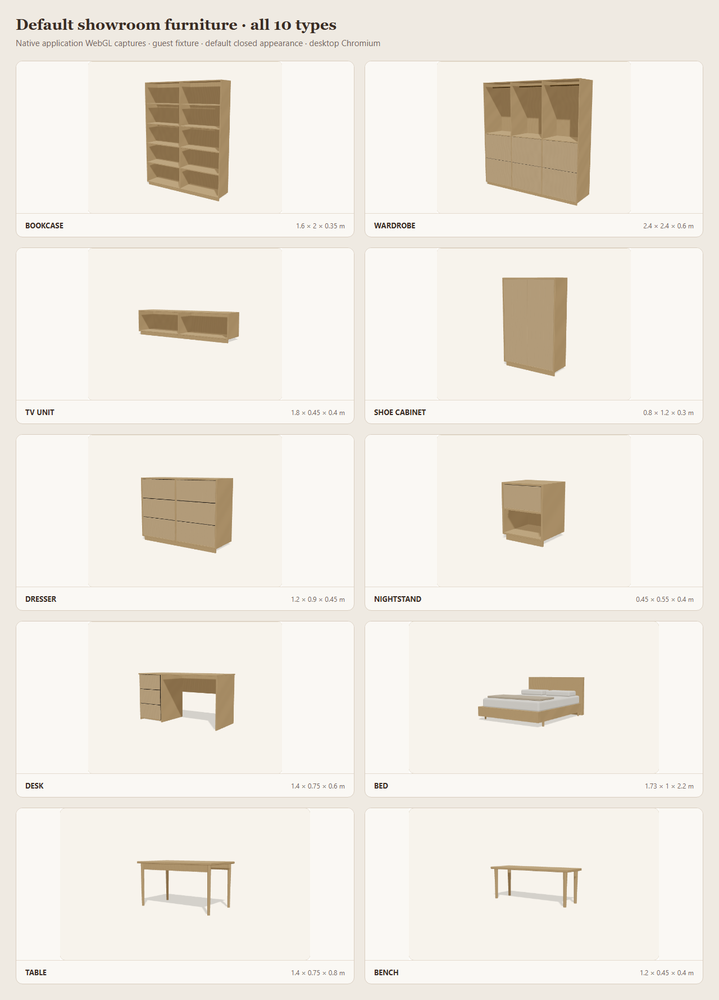

# Default showroom furniture — visual review

Captured 2026-09-15 at 20:00 UTC with `tools/capture-furniture-gallery.mjs`. Result: **all ten default types render; no gross missing or viewport-clipped geometry was observed in the inspected default camera views.** Every capture reported zero JavaScript page errors.

## Evidence

| Type | Observed default geometry | Result |
| --- | --- | --- |
| BOOKCASE | Two open bays, shelves, top/sides/back and base visible | PASS |
| WARDROBE | Three upper open hanging bays with rods, lower front panels and full outer case | PASS |
| TV_UNIT | Low two-bay open case and base; full width stays inside canvas | PASS |
| SHOE_CABINET | Closed full-height front and outer case; front is intentionally not opened in this view | PASS |
| DRESSER | Two columns of drawer fronts, top/sides/base with visible separation | PASS |
| NIGHTSTAND | Upper drawer front, lower open bay, complete outer case | PASS |
| DESK | Worktop, drawer pedestal and opposite side/support; knee opening visible | PASS |
| BED | Frame, headboard, feet, mattress, pillows and throw; full footprint visible | PASS |
| TABLE | Rectangular top, apron/support and four visible legs | PASS |
| BENCH | Slim seat and four visible legs; no upholstery/storage in the default variant | PASS |

Individual native screenshots, the browser-rendered HTML contact sheet and machine-readable capture results are in [screenshots/furniture-gallery](screenshots/furniture-gallery/). The combined image was composed by native browser HTML layout, not raster editing. Dimensions and generated panel counts are retained in [capture-results.json](screenshots/furniture-gallery/capture-results.json).

## Method and reproducibility

- Existing English Studio page: `http://127.0.0.1:3100/en/studio`; desktop headless Chromium, 1440 × 1100 viewport, DPR 1.
- One fresh guest browser context per kind. Fixture uses the exported `PIECE3D_KINDS` and `defaultPieceConfig`, then validates the full scene with `studioDraftDataSchema`.
- Opened the actual **Edit piece** dialog and captured its WebGL canvas after draw calls were observed and the render settled. The application renderer/materials/camera were not replaced.
- Every `/api/v1/` request was intercepted with a guest 401 response. The auth check/refresh requests listed in the capture JSON never reached the backend. No accounts, database records or runtime application files were changed.
- Re-run with the frontend already running: `node tools/capture-furniture-gallery.mjs`. Optional `STUDIO_URL` selects another English Studio URL. Use the repository-supported Node runtime and installed Playwright browser.

## Limits and follow-ups

This closes the bounded default-family visual inventory, not every variant, camera angle, drawer/door animation, minimum/maximum dimension or physical-device GPU combination. The all-variant geometry/schema tests and other browser journeys remain separate evidence.

The style is consistent, restrained wood on a neutral showroom background. Low/wide pieces have more surrounding whitespace than tall storage pieces, and fine procedural grain can appear striped at thumbnail scale. Those are non-blocking visual refinement opportunities, not missing/clipped geometry. The bed's bedding is visual context, not extra quotation items. No application changes were made during this review.
